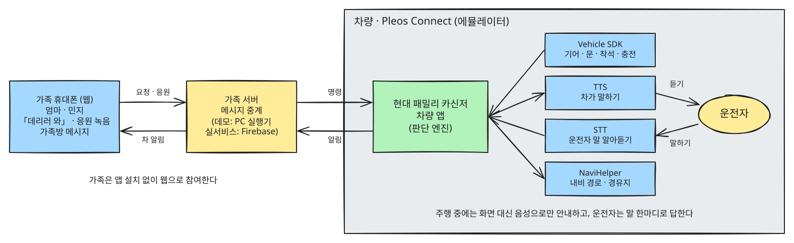
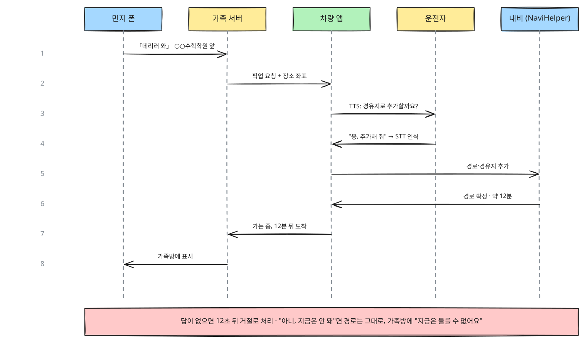
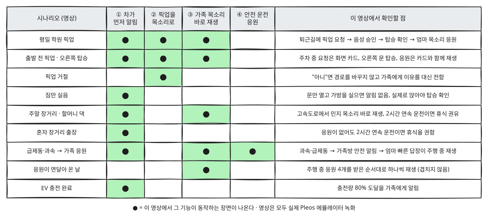

# 현대 패밀리 카신저

> 차가 가족 대화방의 한 구성원이 되어 출발·도착·뒷좌석 탑승을 운전자 대신 가족에게 알리고, 가족의 픽업 요청과 응원 목소리를 운전자가 화면을 만지지 않고 받게 하는 Pleos Connect 앱.

## 시연 영상 (소리 포함)

**▶ [영상 페이지 열기](https://amecoder.github.io/hyundai-family-carsenger/)** — 시나리오 9개 + 직접 조작 시연 1개. 브라우저에서 소리와 함께 바로 재생됩니다(GitHub Pages).

[](https://amecoder.github.io/hyundai-family-carsenger/)

영상 화면은 왼쪽이 시나리오 실행기, 가운데가 Pleos 에뮬레이터의 차량 화면, 오른쪽이 가족 휴대폰 웹입니다. 화면 아래 자막이 지금 단계와 「확인할 것」을 알려 줍니다.

### 한눈에 보는 구조

가족은 휴대폰 웹으로, 운전자는 목소리로만 참여합니다. 차량 앱이 Pleos SDK로 차의 상태를 읽고(Vehicle), 말하고(TTS), 듣고(STT), 내비에 경유지를 넣습니다(NaviHelper).



### 핵심 흐름: 픽업 요청을 목소리로 승인



### 시나리오별 영상



| # | 시나리오 (누르면 영상) | 확인하는 것 | 길이 |
|---|---|---|---|
| 1 | [평일 학원 픽업](https://amecoder.github.io/hyundai-family-carsenger/#pickup) | 출발 → 민지의 픽업 요청 → 음성 승인 → 학원 도착 → 뒷좌석 탑승 확인 → 집 도착·응원 재생 (기능 ①②③) | 57초 |
| 2 | [출발 전 픽업 요청 · 오른쪽 탑승](https://amecoder.github.io/hyundai-family-carsenger/#parked_pickup) | 주차 중에 온 픽업 요청은 화면 카드로 보이고, 오른쪽 뒷문 탑승도 확인하며, 주차 중 응원은 보관 없이 바로 재생하는지 확인 | 56초 |
| 3 | [픽업 거절 (지금은 못 들름)](https://amecoder.github.io/hyundai-family-carsenger/#pickup_decline) | 주행 중 민지의 픽업 요청에 아빠가 "아니"라고 하면, 차는 경로를 바꾸지 않고 가족에게 거절 이유를 대신 전하는지 확인 | 34초 |
| 4 | [짐만 실음 (오탐 방지)](https://amecoder.github.io/hyundai-family-carsenger/#luggage) | 학원 앞에서 뒷문으로 가방만 실으면 알림이 가지 않고, 실제로 앉았을 때만 탑승 확인이 가는지 확인 | 37초 |
| 5 | [주말 장거리 · 휴게소 응원](https://amecoder.github.io/hyundai-family-carsenger/#long_drive) | 고속도로 주행 → 2시간 연속 운전(시연용 20초) → 휴게소 정차 시 민지의 응원 재생 (기능 ③) | 62초 |
| 6 | [혼자 장거리 (휴식 권유)](https://amecoder.github.io/hyundai-family-carsenger/#solo_long_drive) | 응원이 하나도 없어도 2시간 연속 운전(시연용 20초)이면 휴식을 권하고, 휴게소 정차를 가족에게 알리는지 확인 | 46초 |
| 7 | [신호 대기 (재생 안 함 확인)](https://amecoder.github.io/hyundai-family-carsenger/#red_light) | 속도가 0이어도 기어가 D면 응원 음성을 재생하지 않고, 주차(P)했을 때 재생하는지 확인 | 41초 |
| 8 | [응원이 많은 날 (정차 1회당 3개)](https://amecoder.github.io/hyundai-family-carsenger/#many_cheers) | 주행 중 응원이 4개 쌓이면 첫 정차에서 3개만 재생하고, 남은 1개는 다음 정차에서 재생하는지 확인 | 55초 |
| 9 | [EV 충전 완료 알림](https://amecoder.github.io/hyundai-family-carsenger/#ev_charge) | 주차 중 충전량이 목표(80%)에 도달하면 가족에게 알림 (기능 ①) | 22초 |

> 녹화 조건: 모든 영상은 실제 Pleos Connect 에뮬레이터 v2.1.0 녹화입니다. 차량 신호는 Virtual Console을 자동으로 조작했고, 운전자 목소리와 엄마의 녹음은 공개 TTS로 만든 음성을 마이크 대신 넣었습니다(인식은 Pleos STT가 실제로 함). 장거리 시나리오는 2시간 연속 운전을 20초로 줄였습니다. 녹화 스크립트: `pleos-scenario/record_demo.cjs`(시나리오별), `pleos-scenario/record_family_demo.cjs`(직접 조작).

## 저장소 구성

현대자동차그룹 차량용 앱 개발 공모전 출품작입니다(팀 nemo). 이 저장소에는 두 가지가 들어 있습니다.

| 폴더 | 내용 |
|---|---|
| `gajokseok-car/` | 에뮬레이터에 설치하는 **차량 앱** (Kotlin, Pleos Vehicle SDK 2.3.2, TextToSpeech 3.3.1, SpeechToText 3.3.1, NaviHelper 3.0.5) |
| `pleos-scenario/` | **데모 환경**: 시나리오 실행기(Python) + 가족 웹(엄마·아이 폰 역할) + Virtual Console 자동 조작 |
| `apk/` | 바로 설치할 수 있는 차량 앱 APK |

폴더·패키지 이름의 `gajokseok`은 개발 중 가칭(가족석)이며, 앱에 표시되는 이름은 「현대 패밀리 카신저」입니다.

## 주요 기능

- **차가 먼저 알림**: 출발, 도착, 뒷좌석 탑승, 장시간 운전 휴식, 충전 상태를 가족 대화방에 보냅니다.
- **픽업 요청을 목소리로 처리**: 가족이 「데리러 와」를 보내면 차가 음성으로 묻고, 운전자가 "응, 추가해 줘" / "아니, 지금은 안 돼"로 답합니다(Pleos 음성 인식). 승인하면 내비에 픽업 장소가 경로 또는 경유지로 들어갑니다(NaviHelper).
- **응원 녹음**: 가족이 녹음한 응원을 차가 정차했을 때 재생합니다. 주행 중(D)에는 화면 대신 음성으로만 안내합니다.

## APK 위치

- `apk/nemo_현대패밀리카신저_release.apk` (release 빌드, 버전 0.2, 패키지 `dev.gajokseok.car`. 심사용 설치를 위해 디버그 키로 서명)

## 테스트 환경

- Pleos Connect Emulator v2.1.0 (Android Automotive 14, API 34), Android Studio 에뮬레이터
- 호스트: Ubuntu 24.04(x86_64) 또는 macOS(Apple Silicon), Android SDK, Python 3.12 이상(실측 3.14) + [uv](https://docs.astral.sh/uv/), Gradle 9.8
- 그래픽: `-gpu host` 권장 (swiftshader는 장시간 실행 중 에뮬레이터가 스스로 종료되는 것을 확인)

## 실행 방법

### 1. 차량 앱만 설치해 보기

```bash
adb install -r --user 10 "apk/nemo_현대패밀리카신저_release.apk"
adb shell am start --user 10 -n dev.gajokseok.car/.MainActivity
```

Pleos 에뮬레이터의 화면 사용자는 10번입니다. Virtual Console에서 기어·2열 문·2열 착석을 바꾸면 앱이 반응합니다.

### 2. 전체 데모 (추천)

```bash
cd pleos-scenario
./start_demo.sh
```

에뮬레이터 부팅, 차량 앱 빌드·설치, 실행기 서버 시작까지 한 번에 합니다. 브라우저에서 http://127.0.0.1:8090 을 열고 시나리오 버튼을 누르거나, 오른쪽 가족 앱에서 직접 「데리러 와」·「응원 녹음」을 보내 보세요. 자세한 내용은 [`pleos-scenario/README.md`](pleos-scenario/README.md)에 있습니다.

## 필요한 설정

- `ANDROID_HOME` (기본값: 리눅스 `~/Android/Sdk`, macOS `~/Library/Android/sdk`), AVD 이름 `PLEOS_AVD` (기본값 `pleos21`), Gradle 경로 `GRADLE` (기본값 `~/Android/gradle/gradle-9.8.2/bin/gradle`)
- `gajokseok-car/local.properties`에 `sdk.dir=<Android SDK 경로>` 한 줄
- 차량 앱 퍼미션: `CAR_DRIVE`, `CAR_DOORS`, `CAR_SEATS`, `CAR_ENERGY`, `TTS_SERVICE`, `STT_SERVICE`, `NAVI_ROUTE`, `NAVI_ROUTE_SEARCH`, `RECORD_AUDIO`, `FOREGROUND_SERVICE`(`SPECIAL_USE`), `INTERNET` (개발 단계는 선언만으로 동작)
- 데모용 음성 파일(운전자 답변·응원 녹음)은 공개 TTS로 만든 것이며 저장소에 넣지 않았습니다. `PLEOS_VOICE_DIR`(기본 `~/Android/voice`)에 `driver_yes.pcm`, `driver_no.pcm`(16kHz 16bit 모노)을 두면 시나리오가 운전자 목소리로 음성 인식에 넣습니다. 없으면 6초 뒤 「음성 파일·인식 사용 불가 → 시연 응답 적용」을 표시하고 시나리오에 정해 둔 답으로 처리합니다. `cheer_mom.wav`는 시연 녹화 스크립트(`record_family_demo.cjs`)가 가족의 응원 녹음으로 씁니다.
- 가족 앱은 데모에서 PC의 실행기 서버(`10.0.2.2:8090`)를 대역으로 씁니다. 실제 서비스는 Firebase로 연결할 계획입니다.

## 시연 시 주의

- 앱은 포그라운드 서비스로 동작해서 내비가 화면 앞에 있어도 가족 메시지와 음성 안내를 처리합니다.
- 경유지 추가는 내비 앱이 화면 앞에 있어야 동작합니다(NaviHelper 조건). 앱이 승인 직후 내비를 앞으로 띄웁니다.
- 기어가 D이면 Pleos가 서드파티 앱 화면을 덮습니다. 이 앱은 주행 중에는 음성으로만 안내하도록 설계했습니다.

## 테스트

```bash
cd gajokseok-car && gradle test                                   # 판단 엔진·음성 답변 분류 JUnit
cd pleos-scenario && uv run --no-project --with pytest pytest -q   # 실행기·가족 API
```
